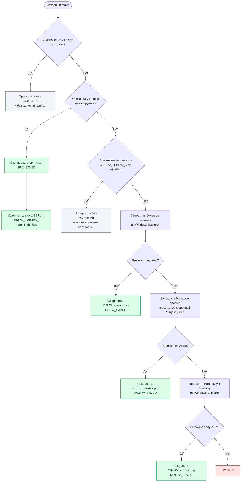

# Восстановление медиатеки Яндекс Диска

Десктопное Java-приложение для бережного восстановления локальной медиатеки, когда часть файлов Яндекс Диска осталась только как облачные заглушки, но их миниатюры видны в Проводнике.

## Запуск

Требуется JDK 21 или новее.

```powershell
.\gradlew.bat run
```

Чтобы получить готовое переносимое Windows-приложение без требования установленной Java, выполните:

```powershell
.\gradlew.bat packageExe
```

Файл запуска будет создан по пути `build\exe\YandexMediaRecovery\YandexMediaRecovery.exe`; рядом с ним уже находится нужный Java Runtime. В правом нижнем углу окна есть ссылка на [репозиторий проекта](https://github.com/Bati4eli/YandexMediaRecovery), открываемая системным браузером.

Первое окно содержит корень локального Диска `%USERPROFILE%\Yandex.Disk`, корень резервной копии `D:\YandexDisk-BACKUP` и встроенное дерево подпапок Диска. В дереве по умолчанию отмечены все папки. Можно снять флажок с большой ветки и включить только нужные вложенные папки; пути в резервной копии при этом остаются относительными к корню Диска. Содержимое дерева подгружается только при раскрытии папки. Служебная папка `.sync` не отображается и не обрабатывается. Корни можно изменить кнопками выбора, а настройки путей сразу сохраняются рядом с программой в `yandex-media-recovery.properties`.

## Что делает программа



Качество результатов: `ORIGIN` → `WEBPV_` → `PREW_` → `MINIPV_`. `WEBPV_` означает серверное превью из веб-клиента Яндекс Диска, `PREW_` — большое локальное превью Explorer, `MINIPV_` — маленькую обложку файла. С включённой по умолчанию настройкой «Удалять менее качественные превью» сохранение более качественного результата удаляет результаты ниже в этой цепочке. Оригинал в папке назначения никогда не заменяется.

Нажмите «Войти в Яндекс Диск…», чтобы приложение открыло Chrome с отдельным постоянным профилем. Вход выполняется пользователем вручную; пароль, cookie и OAuth-токены не попадают в настройки или журналы. Когда после входа откроется корень Диска, видимое окно Chrome автоматически закроется, а сессия сохранится для фонового восстановления. Главный поток последовательно обходит папки, а файлы одной текущей папки распределяются между 1–10 рабочими потоками; переход к следующей папке возможен только после завершения текущей. Браузерный канал намеренно последовательный и делает не более одного нового запроса раз в 200 мс, даже если локальная обработка использует несколько потоков. Следующий запрос начинается только после того, как Chrome закончил загрузку и декодирование текущего большого превью. В окне можно включить перезапись превью, управлять удалением менее качественных `WEBPV_`/`PREW_`/`MINIPV_` и выбрать от 1 до 10 потоков обработки; оба параметра сохраняются. Панель прогресса показывает номер текущего файла, а крупный журнал выводит строку с эмодзи и относительным путём только для изменений. Ошибки отдельных файлов не прерывают остальную операцию.

Флажок «🐞 Отладка браузера (1 поток)» сохраняется в настройках, устанавливает один поток восстановления и показывает Chrome на странице каждого обрабатываемого файла. В консоль пишется открываемый URL. Кнопка «⏹ Остановить восстановление» отменяет рабочие задачи и закрывает управляемый Chrome; исходные файлы и результаты не удаляются.

Для каждого запуска рядом с программой создаётся файл `recovery-log-ГГГГ-ММ-ДД_чч-мм-сс.csv`. В нём после изменения файла сразу сохраняется строка `path,file_name,status`. Статусы: `SRC_SAVED`, `WEBPV_SAVED`, `PREW_SAVED`, `MINIPV_SAVED`, `PREVIEWS_CLEANED`, `NO_FILE`. Файлы, для которых ничего не изменилось, не записываются в CSV.

## Ограничения

Цвет оверлея Яндекс Диска (зелёная галочка/синие стрелки) не доступен Java как надёжное файловое свойство. Перед проверкой содержимого программа использует стандартный Windows-флаг `dos:offline`, чтобы не открывать и не гидратировать облачную заглушку; полный файл всё равно копируется только после реального декодирования. Браузерный вариант требует установленный Chrome и выполненный в отдельном окне вход в Яндекс. Если серверное превью и Shell-кэш недоступны, изображение восстановить технически невозможно.

## Проверка

```powershell
.\gradlew.bat test build
```

Тесты проверяют декодирование, сохранение относительных путей, приоритет уже существующих файлов и запись PNG-превью.
