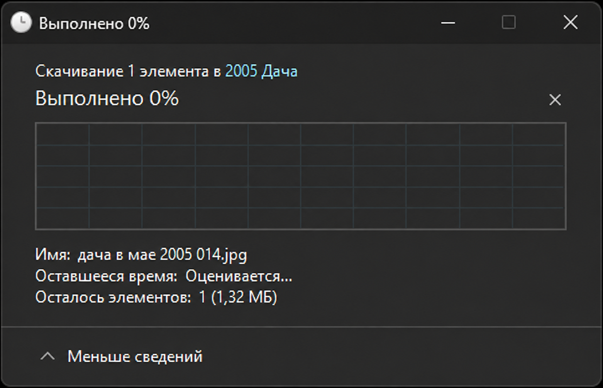
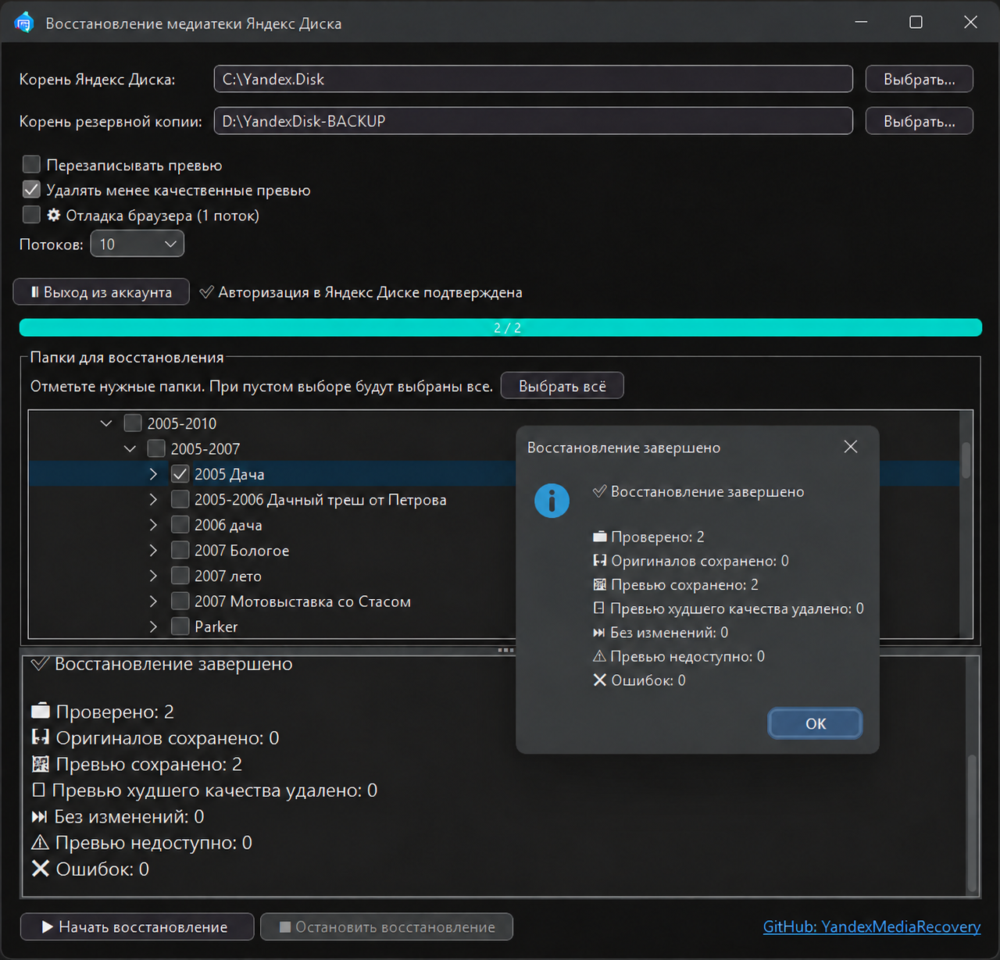

# Yandex Media Recovery

## [⬇️ Скачать последнюю версию](https://github.com/Bati4eli/YandexMediaRecovery/releases/latest)

Это программа-спасатель для старых фото и видео из папки Яндекс Диска.

Иногда в Проводнике фотография **видна**: есть миниатюра, её можно открыть
как превью. Но самого файла на компьютере уже нет — вместо него осталась
облачная заглушка. При попытке скачать оригинал Яндекс Диск может долго
показывать «Выполнено 0%» и ничего не загрузить.

Когда оригиналы недоступны, воспоминания не обязательно потеряны полностью:
часто остаётся хотя бы качественное превью. Эта программа сохраняет такие
превью в обычную резервную папку, со всей исходной структурой каталогов. Это
не вернёт настоящий исходник, но позволит сохранить видимое содержимое фото,
вместо того чтобы потерять его совсем.

## Что именно сохраняется

Программа проходит только по выбранным папкам локального Яндекс Диска и для
каждого фото или видео действует по следующему правилу:

1. Если оригинальный файл реально есть и открывается — копирует оригинал.
2. Если оригинал не скачивается или повреждён — пытается сохранить большое
   превью из Проводника Windows (`PREW_`).
3. Если Проводник не отдал большое превью — получает большое превью из
   авторизованного Яндекс Диска (`WEBPV_`).
4. Если ничего другого не доступно — сохраняет маленькую обложку файла
   (`MINIPV_`).

Качество результатов: **оригинал → WEBPV → PREW → MINIPV**.

Важно: сейчас программа **не умеет скачать недоступный оригинал с серверов
Яндекса**. Если Яндекс не отдаёт исходный файл, она может спасти только то
превью, которое ещё доступно в Проводнике или веб-версии Диска.

Исходная папка никогда не изменяется. Оригиналы в папке резервной копии тоже
никогда не удаляются и не перезаписываются. Приоритет всегда у уже сохранённого
оригинала.

## Как запустить

1. Скачайте ZIP из [Releases](https://github.com/Bati4eli/YandexMediaRecovery/releases/latest) и распакуйте его полностью.
2. Один раз запустите `download-dependencies.bat`. Он загрузит Java Runtime и
   библиотеки, поэтому Java отдельно устанавливать не нужно.
3. Запустите `YandexMediaRecovery.exe`.
4. Выберите корень локального Яндекс Диска, папку для резервной копии и нужные
   ветки дерева.
5. Если нужны превью из веб-версии, нажмите «Войти в Яндекс Диск…», войдите в
   открывшемся Chrome и дождитесь, пока окно закроется.
6. Нажмите «Начать восстановление».

Во время работы видны прогресс и журнал. Рядом с программой создаётся
CSV-журнал с результатом каждого изменённого файла. Настройки путей, выбранных
папок и статуса авторизации сохраняются в `yandex-media-recovery.yaml`.
